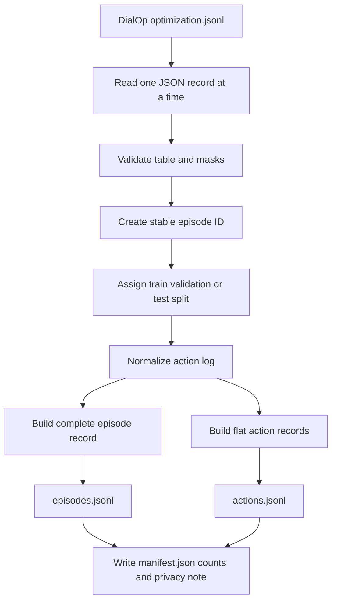
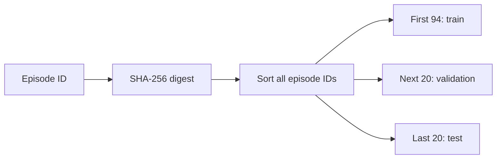
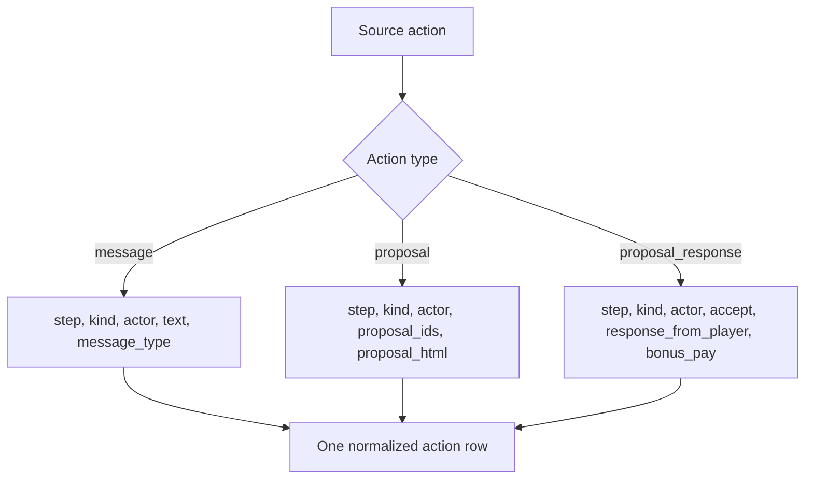
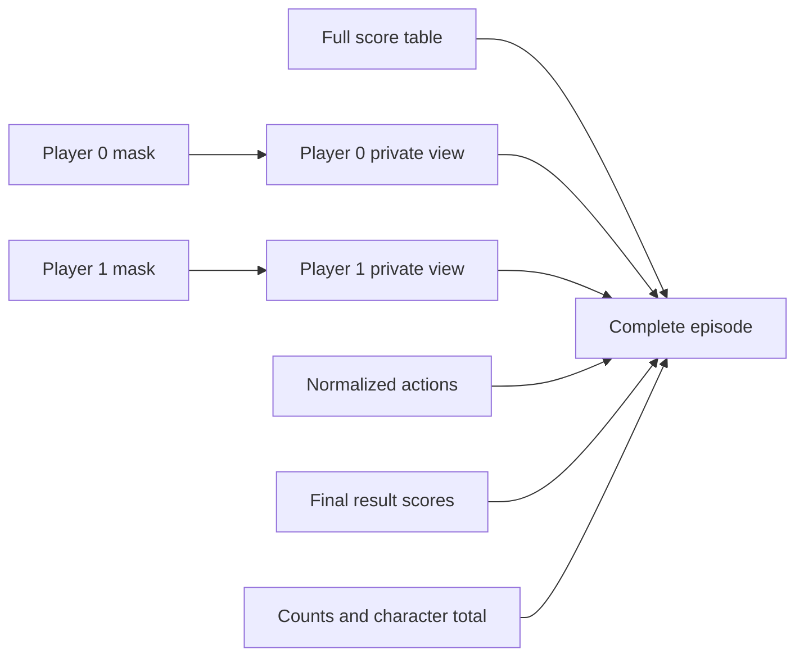
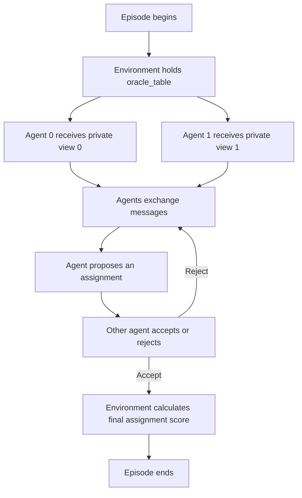
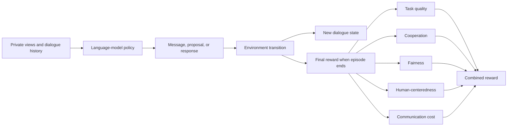
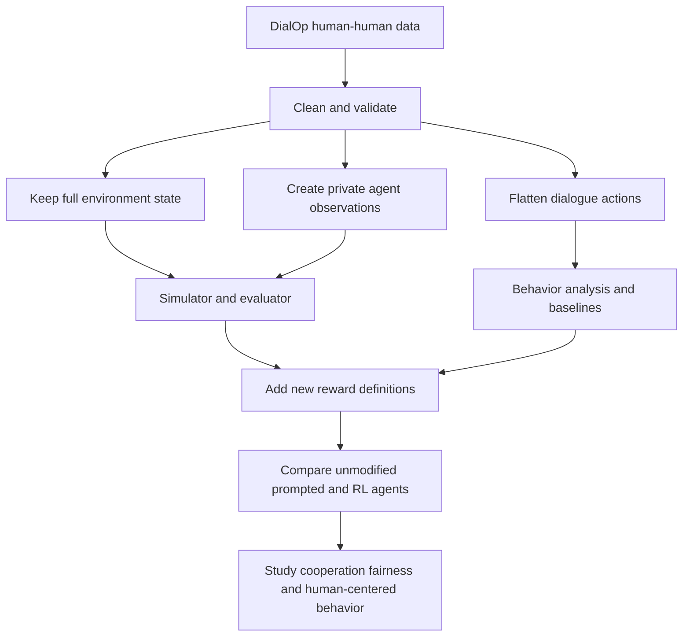

# What Happens to the DialOp Data?

This guide explains the data in this folder in simple terms. It covers:

1. What the original DialOp data represents.
2. What `scripts/build_dataset.py` changes.
3. What is saved in each processed file.
4. What the processed data can support in the project proposal.
5. What is **not** in the data yet and must be added for the reinforcement-learning experiments.

The short version is:

> DialOp gives us human-human conversations about assigning reviewers to papers when each person has different information. The processing script turns those conversations into clean episodes and action records that can be used by a simulator, an analysis pipeline, or an offline behavior model. It does not yet train an agent or add fairness, cooperation, or human-centered reward labels.

## 1. The project proposal in one paragraph

The proposal asks whether two language-model agents can learn to cooperate when they have different information and possibly different preferences. The agents must assign eight reviewers to eight papers. They need to communicate, make proposals, respond to each other, and reach a final assignment.

The DialOp reviewer-assignment task is a useful starting point because it already contains:

- two participants;
- private, incomplete information;
- a shared assignment problem;
- natural-language discussion;
- proposals and accept/reject decisions; and
- a numerical score for the final assignment.

The proposal goes further than the original data by asking about cooperation, fairness, and the effect of decisions on people such as authors, reviewers, and conference attendees.

## 2. What is in the original DialOp record?

The source used by the script is:

`data/raw/optimization.jsonl`

The original DialOp implementation is the authority for the scaling and
reward conventions. See the [Microsoft DialOp repository](https://github.com/microsoft/dialop),
[`dialop/games/optimization.py`](https://github.com/microsoft/dialop/blob/main/dialop/games/optimization.py),
and the paper [Decision-Oriented Dialogue for Human-AI Collaboration](https://arxiv.org/abs/2305.20076).

The project deliberately uses the **optimization** data. It does not use the `itinerary.jsonl` or `mediation.jsonl` files for this conversion.

Each source line is one complete human-human interaction. The record contains the following important pieces:

| Source field | Simple meaning | How the project uses it |
|---|---|---|
| `table` | An 8×8 score matrix. Each cell says how suitable one worker is for one paper. | Kept as the environment's hidden/oracle table. |
| `mask1` | The cells visible to player 0. | Used to create player 0's private view. |
| `mask2` | The cells visible to player 1. | Used to create player 1's private view. |
| `action_log` | The conversation and decisions in time order. | Normalized into messages, proposals, and responses. |
| `best_assignment_reward` | DialOp's pooled-observation reference matching score. | Denominator for the original normalized reward. |
| `result.score` | The score of the assignment reached by the human participants. | Saved as the human final outcome. |
| `result.best` | The best score recorded for that episode. | Saved as `best_score`. |
| `result.worst` | The worst score recorded for that episode. | Saved as `worst_score`. |
| `result.norm` | `proposal_reward / best_assignment_reward`. | Saved as `normalized_score` and audited against the formula. |
| `scale1`, `scale2` | Independent player scales sampled in the original game. | Preserved for auditability and applied only to visible private cells. |

### Exact DialOp scaling convention

The original implementation samples each scale from `Uniform(1, 10)` and
preprocesses a visible score as:

```text
visible_player_cell = int(oracle_table_cell * player_scale)
hidden_player_cell = null
```

The `int(...)` conversion is part of the original implementation. The
processed `oracle_table` is never scaled or overwritten. Each processed
`private_views[player].table` contains only the scaled cells visible to that
player; hidden cells are `null`. The observation helper omits scale metadata,
the oracle table, and the other player's view from the agent-facing object.

The matrix can be thought of like this:

|  | Paper 0 | Paper 1 | ... | Paper 7 |
|---|---:|---:|---:|---:|
| Worker 0 | score | score | ... | score |
| Worker 1 | score | score | ... | score |
| ... | ... | ... | ... | ... |
| Worker 7 | score | score | ... | score |

The two people do not see the whole matrix. A `1` in a mask means “this cell is visible”; a `0` means “this cell is hidden.”

## 3. The processing pipeline

The script performs a data conversion. It does not perform model training.



### Step 1: Read the JSONL file

The file is read line by line. Blank lines are skipped. Every non-blank line must be a JSON object.

If a line is invalid JSON, or is not an object, the script stops with an error instead of silently producing bad data.

### Step 2: Validate the assignment matrices

For every episode, the script requires:

- `table` to have 8 rows and 8 columns;
- `mask1` to have 8 rows and 8 columns;
- `mask2` to have 8 rows and 8 columns; and
- mask values to be binary: `0` or `1`.

This protects the later simulator from receiving matrices with the wrong shape.

### Step 3: Create an episode ID

The script creates IDs such as:

```text
optimization-0000
optimization-0001
optimization-0002
```

The ID is based on the record's position in the source file. It gives every episode a stable name that can be shared between `episodes.jsonl` and `actions.jsonl`.

### Step 4: Split by episode

The script sorts episode IDs by their SHA-256 digest and assigns complete
episodes to splits. The target is 70% train, 15% validation, and 15% test.
For the current 134 episodes, this produces 94 train, 20 validation, and 20
test episodes:



The important point is that the split is made **before** using individual dialogue turns. Every action from one episode stays in the same split. This prevents a model from seeing the beginning of a conversation during training and the end of that same conversation during testing.

The current split is:

| Split | Episodes | Approximate share |
|---|---:|---:|
| Train | 94 | 70.1% |
| Validation | 20 | 14.9% |
| Test | 20 | 14.9% |
| **Total** | **134** | **100%** |

### Step 5: Normalize each action

The source action log has different nested shapes for messages, proposals, and responses. The script converts them into one common format.



Common fields added to every normalized action are:

| Field | Meaning |
|---|---|
| `step` | Position in the episode action sequence, starting at 0. |
| `kind` | `message`, `proposal`, or `proposal_response`. |
| `actor` | Which player acted: 0 or 1. |
| `elapsed_seconds` | Included when the original action had a time value. |

The action-specific fields are:

| Action kind | Stored information |
|---|---|
| `message` | Speaker, text, and message type. |
| `proposal` | The assignment IDs and the proposal's HTML display text. |
| `proposal_response` | Whether the proposal was accepted, who responded, and any bonus pay. |

This means the language is still available. The script does not replace the dialogue with only a numeric label.

### Step 6: Create each complete episode

The episode record combines the environment information, private observations, dialogue, outcomes, and summary metrics.



The `private_view` function replaces hidden cells with `null`:

```text
full table cell:       74
mask value:             1
player scale:       6.2647
private-view cell:    463

hidden full table cell: 74
mask value:             0
private-view cell:   null
```

When the mask value is `1`, the score is multiplied by that player's scale
and converted with `int(...)`. When it is `0`, the score is hidden as `null`.

## 4. What is saved in each processed file?

### `episodes.jsonl`: the simulator and evaluator view

There is one line per episode: 134 lines total.

Each line contains:

```text
episode_id
task
split
workers
papers
oracle_table
private_views
agent_scales
best_assignment_reward
human_outcome
actions
metrics
```

This is the file for building an environment because it contains both:

- the hidden full table that the environment needs to calculate assignment quality; and
- the limited views that the agents are allowed to see.

Each private view stores its player ID, scale, observed mask, and already-scaled
table. Important: `episodes.jsonl` stores the oracle table for convenience. The
environment must not pass `oracle_table` directly into an agent prompt. It
should pass only that agent's scaled private view through the observation
helper.

### `actions.jsonl`: the flat dialogue-analysis view

There is one line per action: 2,068 lines total.

Each action line contains:

```text
episode_id
task
split
step
kind
actor
elapsed_seconds, when available
text or proposal fields or response fields
```

This file is easier to use for:

- counting messages and proposals;
- studying how people communicate;
- behavior cloning or supervised dialogue experiments;
- making action-level plots; and
- checking whether a model produces the same kinds of actions.

It intentionally does **not** contain `oracle_table` or `private_views`. That reduces the chance that a dialogue model accidentally learns the hidden answer from the training examples.

### `manifest.json`: a quick summary

The manifest records:

- the source path;
- the task name;
- the number of episodes;
- the number of actions;
- the split counts; and
- the privacy boundary around `oracle_table` and `private_views`.

## 5. What the processed data looks like numerically

The current processed data contains:

| Quantity | Value |
|---|---:|
| Episodes | 134 |
| Normalized actions | 2,068 |
| Messages | 1,610 |
| Proposals | 231 |
| Proposal responses | 227 |
| Actions per episode, average | 15.43 |
| Messages per episode, average | 12.01 |
| Proposals per episode, average | 1.72 |
| Dialogue characters per episode, average | 856.41 |

### Graph 1: action types

The bars are scaled relative to the largest category. The percentages are percentages of all 2,068 normalized actions.

```text
Messages            1,610  77.9%  |███████████████████████████████████████|
Proposals             231  11.2%  |██████                                  |
Proposal responses    227  11.0%  |█████                                   |
```

This shows that most of the dataset is natural-language communication. Proposals and accept/reject decisions are less frequent, but they are the actions that move the conversation toward a final assignment.

### Graph 2: final human score compared with the recorded best

The original final score is compared with the recorded best assignment reward.

```text
Human final score       566.69  |██████████████████████████████████      |
Recorded best reward    614.93  |█████████████████████████████████████   |
Average gap              48.24  |███                                     |
```

These bars are a simple visual comparison, not a percentage scale. The exact averages are more important than the bar length.

The episode-level results are:

| Outcome | Episodes |
|---|---:|
| Human score equals recorded best | 29 |
| Human score is below recorded best | 105 |
| Human score is zero | 0 |
| Mean normalized score | 0.92 |
| Minimum normalized score | 0.62 |
| Maximum normalized score | 1.00 |

This is useful for the project. The human conversations are meaningful demonstrations, but they should not automatically be treated as optimal actions. Most episodes do not reach the recorded best score.

### Graph 3: how much information each player sees

There are 64 cells in one complete 8×8 table. Across all 134 episodes, each player has 8,576 possible private-view cells.

```text
Player 0 visible cells   3,322 / 8,576  38.74%  |███████████████████                   |
Player 1 visible cells   3,252 / 8,576  37.92%  |███████████████████                   |
Either player sees cell  5,482 / 8,576  63.90%  |████████████████████████████████      |
```

The two players together see more of the table than either one sees alone. Some cells overlap: 1,092 cells are visible to both players. This creates a genuine reason to communicate: one player may know something important that the other player cannot see.

## 6. What is different from the original DialOp data?

The processed data is not a new set of conversations. The underlying task, human dialogue, proposals, and outcomes come from DialOp. The main difference is the organization, exact player scaling, and safety boundary.

| Original DialOp record | Processed representation | Why it matters |
|---|---|---|
| One nested source object | One stable episode object with an ID | Makes episodes easy to reference. |
| Nested action structures | Common normalized action schema | Makes messages, proposals, and responses easier to analyze together. |
| `table` | `oracle_table` in `episodes.jsonl` | Makes its role as hidden environment information explicit. |
| `mask1` and `mask2` | `private_views` with hidden cells changed to `null` and visible cells scaled | Reproduces the original DialOp player observations without changing the oracle. |
| No project split field | Deterministic `train`, `validation`, and `test` split | Prevents conversation leakage across splits. |
| Action details mixed into the record | Summary metrics | Makes episode-level analysis easier. |
| Human outcome fields in the source result | `human_outcome` | Gives the evaluator a consistent place to find final scores and normalized reward. |
| Full episode context | Flat action rows in `actions.jsonl` | Supports dialogue analysis without exposing the hidden matrix. |

The processed schema preserves `proposal_reward` inside `human_outcome` so the audit can compare it with the raw source and recompute accepted proposal scores. Some other source details, such as `start_time`, are intentionally not copied because they are not needed by the simulator or dialogue analysis.

## 7. What the processed data does **not** contain

This is the most important limitation for interpreting the project results.

The current data does **not** contain explicit labels for:

- cooperation quality;
- fairness;
- author utility;
- reviewer workload or welfare;
- attendee benefit;
- deception or exploitation;
- whether an agent considered the other agent's interests;
- whether a message was helpful or unnecessary;
- conflicting agent goals; or
- a reward for every individual action.

The original score table gives a basis for assignment quality. It does not by itself say that an assignment is fair or human-centered.

For example, a high-scoring assignment could still give one reviewer an unfair workload if the project later includes workload constraints. That fairness concept must be defined separately; it cannot be safely inferred from the dialogue text alone.

## 8. How this supports the project proposal

The processed data supports the proposal in four main ways.

### A. It provides a reproducible environment starting point

The simulator can use one processed episode as follows:



The full table is used by the environment, not shown to the agents. The agents must use communication to discover useful information and make a good joint assignment.

### B. It provides human behavior for comparison

The human actions can be used to ask questions such as:

- How often do people share information?
- How many proposals are usually needed?
- How often are proposals rejected?
- Do people revise an assignment after hearing new information?
- How long are conversations before acceptance?

The data can also support behavior cloning or supervised fine-tuning. However, the human action sequence should be treated as a demonstration, not as a guaranteed optimal policy, because 105 of 134 episodes are below the recorded best score.

### C. It supplies the first task-quality reward

The original assignment table gives the proposal a grounded task-quality signal. DialOp's actual normalized reward is:

```text
normalized_score = proposal_reward / best_assignment_reward
```

The current raw data satisfies this equality exactly for all 134 episodes. `best_assignment_reward` is not necessarily the global optimum under the full oracle table. DialOp chooses a matching using the agents' pooled observations, treating unknown edges as the midpoint before choosing the matching, and then scores that matching with the unchanged oracle table. During RL, the simulator should calculate the same reference and score a model-generated final matching with the oracle table.

### D. It creates a controlled partial-information test

Because the two private views are different, the project can test whether an agent:

- communicates information that the partner does not have;
- listens to information from the partner;
- changes its proposal after receiving useful information;
- resolves disagreements; and
- reaches a high-quality final assignment without seeing the hidden table.

These behaviors are closely related to the proposal's question about prosocial cooperation.

## 9. What must be added for the full proposal

The current script prepares the data, but the full proposal needs an additional environment and reward layer.

| Proposal goal | Present now? | What must be added |
|---|---|---|
| Reviewer-assignment task | Yes | Use the existing table, worker list, and paper list. |
| Two private information views | Yes | Enforce the views in the agent interface. |
| Human dialogue demonstrations | Yes | Use `actions` for analysis, prompting, or behavior cloning. |
| Assignment-quality score | Yes, in basic form | Calculate the score for every model-generated final assignment. |
| Conflicting agent preferences | No | Add different objectives or preference weights for the two agents. |
| Cooperation reward | No | Define measurable agreement progress, useful information sharing, and unnecessary rejection penalties. |
| Fairness reward | No | Define a fairness metric, such as balanced reviewer workload or bounded quality disparity. |
| Human-centered reward | No | Define utility or harm measures for authors, reviewers, and conference attendees. |
| Communication cost | No | Add message length, number of turns, delay, or unnecessary-message penalties. |
| GRPO training | No | Build rollouts, calculate rewards, group samples, and optimize the selected language model. |
| Self-play | No | Start with one learned agent and one fixed partner, then extend to two learned agents. |

The README describes a useful initial reward decomposition:

```text
normalized_score   = proposal_reward / best_assignment_reward
cooperation        = agreement_progress - unnecessary_rejections
fairness           = stakeholder-specific fairness metric
human_centeredness = author/reviewer/attendee utility metric
communication      = bounded information gain - message cost
```

Only the first term is grounded directly in the current DialOp score. The other terms need to be documented definitions, annotations, or synthetic scenario functions.

## 10. A simple RL interpretation

The processed data gives the environment and the demonstrations. The proposed RL experiment adds a policy and a reward.



A simple experimental progression is:

1. **Unmodified language model:** measure what happens without special training.
2. **Cooperation-prompted model:** give explicit instructions about sharing information, resolving conflict, and considering people affected by the assignment.
3. **RL model:** train with task quality first, then compare task-only reward against a combined cooperation and human-centered reward.
4. **Fixed-partner setting:** train one agent while the other agent follows a fixed policy or recorded behavior.
5. **Self-play extension:** train both agents only after the reward and evaluation are stable.

This order keeps it possible to tell whether an improvement comes from the prompt, from reinforcement learning, or simply from a different base model.

## 11. What a fair evaluation should measure

The proposal should not judge cooperation only by whether the agents agree. Agreement can be bad if both agents agree on a poor or unfair assignment.

| Metric | Question it answers |
|---|---|
| Final assignment score | Did the agents assign workers effectively? |
| Normalized task quality | How close was the result to DialOp's pooled-observation reference? |
| Fairness | Were the effects distributed acceptably across stakeholders? |
| Completion rate | Did the agents reach an accepted assignment? |
| Number of proposals | How much back-and-forth was needed? |
| Rejection count | Did the agents resolve disagreements efficiently? |
| Useful information sharing | Did messages reveal information relevant to the decision? |
| Communication length | Did the agents use more communication than necessary? |
| Preference resolution | Did agents find compromises when their objectives differed? |
| Human-centered outcome | Did the result protect or improve the defined stakeholder utilities? |

The existing `metrics` object provides starting measurements for action count, message count, proposal count, response count, accepted responses, and dialogue characters. It does not provide the fairness or human-centered metrics yet.

## 12. Important cautions

### The oracle table must stay hidden from agents

`episodes.jsonl` contains the full `oracle_table` because the simulator and evaluator need it. A training or inference prompt should expose only the relevant `private_views` entry.

### Do not split by action

The script assigns exactly 94/20/20 complete episodes by sorted SHA-256 digest. All actions from one dialogue stay in the same split. The test set is still small, so results should be treated as an initial diagnostic rather than strong evidence of generalization.

### Human behavior is not automatically optimal

The human dialogues are valuable examples of information exchange and negotiation. They are not proof that every human proposal is the best possible action.

### Do not call task score fairness

The score measures assignment quality according to the original DialOp setup. Fairness and human-centeredness require their own definitions and measurements.

### The current dataset does not contain the proposal's conflicts yet

The original setup has different information and independently scaled views, but the full proposal also discusses conflicting objectives and reviewer preferences. Those conflicts need to be added through scenario generation or explicit preference functions.

### The normalized reward is not a fairness or human-welfare label

`normalized_score` measures task reward relative to the DialOp pooled-knowledge reference. It does not measure cooperation, fairness, author utility, reviewer welfare, or attendee benefit. Those remain new experiment-layer objectives.

## 13. Final mental model



In one sentence:

> The processed DialOp data is the task-and-demonstration foundation for the project, while the cooperation, fairness, human-centered objectives, synthetic conflicts, and GRPO training loop are the new research layer that still needs to be implemented.

## Related files

- [`scripts/build_dataset.py`](./scripts/build_dataset.py) — the command-line data builder.
- [`src/preprocessing.py`](./src/preprocessing.py) — reusable conversion logic.
- [`src/environment.py`](./src/environment.py) — safe player-specific observations.
- [`README.md`](./README.md) — the short project description and modeling boundary.
- [`data/processed/episodes.jsonl`](./data/processed/episodes.jsonl) — complete episode records for the simulator and evaluator.
- [`data/processed/actions.jsonl`](./data/processed/actions.jsonl) — flattened action records for dialogue analysis.
- [`data/processed/manifest.json`](./data/processed/manifest.json) — counts, splits, and the privacy note.
